# MoveInSync EV Fleet Charging & Trip Assignment Optimizer
## System Architecture & Technical Design Document

---

## 1. Problem Summary

Modern corporate employee transportation requires balancing zero-emission sustainability goals with stringent service reliability. Electric vehicles (EVs) present distinct operational constraints compared to internal combustion engine (ICE) vehicles:
- **Finite range & battery depletion:** Vehicles must avoid roadside stranding and deep discharge degradation.
- **Non-linear battery charging profiles:** Charging is fast up to 80% State of Charge (SoC), tapering significantly above 80% in the Constant Voltage (CV) phase.
- **Constrained charging infrastructure:** Fixed number of chargers per hub and power delivery ratings.
- **Dynamic electricity pricing:** Peak vs. off-peak tariffs incentivize overnight or shoulder-period charging.
- **Service punctuality:** Employee trips operate under fixed schedules and strict latest allowed finish times.

### Primary Objectives Hierarchy
1. **Minimize trips requiring backup petrol/diesel cabs:** Service punctuality and full trip coverage are the highest operational priority.
2. **Minimize electricity cost:** Among candidate schedules with identical backup counts, minimize aggregate charging expenditure through tariff-aware scheduling.

---

## 2. Full Project Requirements Checklist

- [x] **Phase 1: Domain Foundation & Core Calculations** (Status: COMPLETE)
  - [x] Immutable `Location` with Haversine distance, symmetry, spherical curvature, boundary validation.
  - [x] Half-open `TimeWindow` `[start, end)` with non-overlapping adjacent intervals.
  - [x] Timezone-aware electricity `TariffSchedule`, midnight-crossing windows, and DST handling.
  - [x] `EnergyModel` with configurable traffic and AC consumption multipliers.
  - [x] `BatterySafetyCalculator` enforcing strict 15% state-of-charge reserve floor.
  - [x] `TwoPartChargingCurve` modeling fast charging (&lt;80% SoC) and taper (&gt;80% SoC).
  - [x] Invariant-enforcing domain models: `Vehicle`, `Trip`, `ChargerHub`, `ChargingSession`.
  - [x] Comprehensive automated JUnit 5 & AssertJ unit test suite (116 tests passing).
- [ ] **Phase 2: Trip Feasibility & Travel Time Modeling** (Status: PLANNED)
  - [ ] Road routing distance matrix and speed models.
  - [ ] Empty (deadhead) travel from vehicle location to pickup.
  - [ ] Battery drain for empty travel and passenger trip combined.
- [ ] **Phase 3: Trip Assignment Engine** (Status: PLANNED)
  - [ ] Heuristic and mathematical formulation for 1,500 trips across 300 EVs.
  - [ ] Backup petrol/diesel cab fallback minimization.
  - [ ] Plan generation within 30-second full-shift benchmark target.
- [ ] **Phase 4: Charging Scheduler & Hub Capacity** (Status: PLANNED)
  - [ ] Multi-charger concurrent slot allocation without exceeding hub charger count.
  - [ ] Cost-optimal scheduling taking advantage of off-peak electricity tariffs.
- [ ] **Phase 5: Independent Plan Validator** (Status: PLANNED)
  - [ ] Deterministic replay and verification of every generated fleet plan.
  - [ ] Detection of overlapping vehicle assignments, battery floor breaches, or charger oversubscription.
- [ ] **Phase 6: Live Replanning Engine** (Status: PLANNED)
  - [ ] Sub-2-second incremental replanning on telemetry drift and charger outages.
- [ ] **Phase 7: Persistence, REST APIs, Observability & Security** (Status: PLANNED)
  - [ ] PostgreSQL persistence, multi-tenant isolation, role-based access control.
  - [ ] REST API endpoints, structured logging, Prometheus metrics, Docker Compose orchestration.

---

## 3. Phase 1 Scope & Architectural Boundaries

Phase 1 establishes the mathematical foundation and domain core of the system:
- **Clean Architecture / Hexagonal Isolation:** Domain models (`Vehicle`, `Trip`, `ChargerHub`, `ChargingSession`, `Location`) and calculation engines (`EnergyModel`, `BatterySafetyCalculator`, `ChargingCurve`, `TariffSchedule`) are completely independent of HTTP, Spring Data, PostgreSQL, cloud services, and external transport layers.
- **Self-Validating Invariants:** Entities and value objects validate all construction parameters directly, failing immediately on invalid identifiers, non-positive physical dimensions, out-of-range coordinates, or reversed time windows.
- **Explicit Omissions in Phase 1:** Full charger slot assignment, graph road-routing, and solver algorithms are deliberately omitted in Phase 1 to prevent speculative boilerplate.

---

## 4. Architecture Diagram

```
+---------------------------------------------------------------------------------+
|                                 DOMAIN CORE                                     |
|                                                                                 |
|   +--------------------------+               +------------------------------+   |
|   |         Vehicle          |               |             Trip             |   |
|   |--------------------------|               |------------------------------|   |
|   | - VehicleSpecification   |               | - TripId, TenantId           |   |
|   | - VehicleState           |               | - StartLocation, Destination |   |
|   | - Availability & Status  |               | - ScheduledStartTime         |   |
|   +------------+-------------+               | - LatestAllowedFinishTime    |   |
|                |                             +------------------------------+   |
|                v                                                                |
|   +--------------------------+               +------------------------------+   |
|   |  BatterySafetyCalculator |               |         EnergyModel          |   |
|   |--------------------------|               |------------------------------|   |
|   | - 15% Reserve Floor      |<--------------| - Base Consumption           |   |
|   | - Usable Energy Above Res|               | - Traffic Multiplier         |   |
|   | - Trip Feasibility Check |               | - AC Multiplier              |   |
|   +--------------------------+               +------------------------------+   |
|                                                                                 |
|   +--------------------------+               +------------------------------+   |
|   |      ChargerHub          |               |       ChargingSession        |   |
|   |--------------------------|               |------------------------------|   |
|   | - HubId, TenantId        |               | - SessionId, VehicleId, HubId|   |
|   | - ChargerCount (N)       |               | - TimeWindow [start, end)    |   |
|   | - ChargerPowerKw (kW)    |               | - StartSoc, EndSoc           |   |
|   | - TariffSchedule         |               | - Energy Delivered (kWh)     |   |
|   +------------+-------------+               | - Estimated Cost (Money)     |   |
|                |                             +--------------+---------------+   |
|                v                                            |                   |
|   +--------------------------+                              v                   |
|   |      TariffSchedule      |               +------------------------------+   |
|   |--------------------------|               |        ChargingCurve         |   |
|   | - ZoneId & LocalTime     |<--------------|------------------------------|   |
|   | - Midnight-Crossing Slots|               | - Two-Part Piecewise Linear  |   |
|   | - Cost Integration       |               | - Fast (<80%) & Taper (>80%) |   |
|   +--------------------------+               +------------------------------+   |
|                                                                                 |
|                +-------------------------------------------+                    |
|                |                 Location                  |                    |
|                |-------------------------------------------|                    |
|                | - Latitude [-90, 90], Longitude [-180,180]|                    |
|                | - Haversine Distance Calculation (km)     |                    |
|                +-------------------------------------------+                    |
+---------------------------------------------------------------------------------+
```

---

## 5. Mermaid Class Diagram

```mermaid
classDiagram
    class Location {
        +double latitude
        +double longitude
        +double distanceTo(Location other)
    }

    class TimeWindow {
        +Instant start
        +Instant end
        +boolean overlaps(TimeWindow other)
        +boolean contains(Instant instant)
        +boolean isAdjacentTo(TimeWindow other)
        +Optional~TimeWindow~ intersection(TimeWindow other)
        +Duration duration()
    }

    class VehicleSpecification {
        +double batteryCapacityKwh
        +double baseConsumptionKwhPerKm
    }

    class VehicleState {
        +Location currentLocation
        +double stateOfCharge
        +VehicleAvailability availability
    }

    class VehicleAvailability {
        +Instant availableFrom
        +Location availableAtLocation
        +VehicleStatus status
    }

    class Vehicle {
        +String vehicleId
        +String tenantId
        +VehicleSpecification specification
        +VehicleState state
        +Vehicle withUpdatedState(VehicleState newState)
        +Vehicle withUpdatedSocAndLocation(double newSoc, Location loc, Instant time)
    }

    class Trip {
        +String tripId
        +String tenantId
        +Location startLocation
        +Location destination
        +double distanceKm
        +Instant scheduledStartTime
        +Instant latestAllowedFinishTime
    }

    class ChargerHub {
        +String hubId
        +String tenantId
        +Location location
        +int chargerCount
        +double chargerPowerKw
        +TariffSchedule tariffSchedule
        +double getTotalPotentialPowerKw()
    }

    class ChargingSession {
        +String sessionId
        +String vehicleId
        +String hubId
        +Instant startTime
        +Instant endTime
        +double startSoc
        +double endSoc
        +double energyDeliveredKwh
        +BigDecimal estimatedCost
        +String currency
        +void validateAgainstBatteryCapacity(double batteryCapacityKwh)
    }

    class EnergyModel {
        <<interface>>
        +double calculateEffectiveConsumption(double base, EnergyFactors factors)
        +double calculateEnergyRequired(double distance, double base, EnergyFactors factors)
    }

    class StandardEnergyModel {
        +double calculateEffectiveConsumption(double base, EnergyFactors factors)
        +double calculateEnergyRequired(double distance, double base, EnergyFactors factors)
    }

    class BatterySafetyCalculator {
        <<utility>>
        +double MINIMUM_RESERVE_SOC = 0.15
        +double calculateMinimumReserveEnergy(double capacity)
        +double calculateCurrentEnergy(double capacity, double soc)
        +double calculateAvailableEnergyAboveReserve(double capacity, double soc)
        +boolean isAboveOrAtReserve(double soc)
        +boolean canSustainTrip(double capacity, double soc, double energyRequired)
        +double calculateMaxFeasibleDistanceKm(double capacity, double soc, double consumption)
    }

    class ChargingCurve {
        <<interface>>
        +double calculateChargingTimeHours(double capacity, double startSoc, double targetSoc, double power)
        +double calculateEnergyDeliveredKwh(double capacity, double startSoc, double targetSoc)
        +double calculateResultingSoc(double capacity, double startSoc, double hours, double power)
    }

    class TwoPartChargingCurve {
        +double socThreshold = 0.80
        +double fastRateMultiplier = 1.0
        +double taperMultiplier = 0.50
        +double calculateChargingTimeHours(double capacity, double startSoc, double targetSoc, double power)
        +double calculateEnergyBelowThreshold(double capacity, double startSoc, double targetSoc)
        +double calculateEnergyAboveThreshold(double capacity, double startSoc, double targetSoc)
    }

    class TariffSchedule {
        +ZoneId zoneId
        +String currency
        +List~TariffSlot~ slots
        +TariffRate defaultRate
        +TariffRate getRateAt(Instant instant)
        +BigDecimal calculateCost(Instant start, Instant end, double energyKwh)
    }

    Vehicle --> VehicleSpecification
    Vehicle --> VehicleState
    VehicleState --> Location
    VehicleState --> VehicleAvailability
    VehicleAvailability --> Location
    Trip --> Location
    ChargerHub --> Location
    ChargerHub --> TariffSchedule
    StandardEnergyModel ..|> EnergyModel
    TwoPartChargingCurve ..|> ChargingCurve
```



---

## 6. Energy, Reserve, and Charging Mathematical Formulas

### A. Great-Circle Haversine Distance
Given coordinates $\phi_1, \lambda_1$ and $\phi_2, \lambda_2$ in radians:
$$\Delta\phi = \phi_2 - \phi_1, \quad \Delta\lambda = \lambda_2 - \lambda_1$$
$$a = \sin^2\left(\frac{\Delta\phi}{2}\right) + \cos(\phi_1)\cos(\phi_2)\sin^2\left(\frac{\Delta\lambda}{2}\right)$$
$$c = 2 \cdot \operatorname{atan2}\left(\sqrt{a}, \sqrt{1 - a}\right)$$
$$d = R_{\text{Earth}} \cdot c \quad (R_{\text{Earth}} = 6371.0\text{ km})$$

### B. Energy Consumption Model
$$\text{effectiveConsumption} (\text{kWh/km}) = \text{baseConsumption} \times \text{trafficMultiplier} \times \text{acMultiplier}$$
$$\text{energyRequired} (\text{kWh}) = \text{distanceKm} \times \text{effectiveConsumption}$$

### C. Battery Reserve Floor (15% Invariant)
For battery capacity $B$ (kWh) and state of charge $S \in [0.0, 1.0]$:
$$E_{\text{reserve}} = 0.15 \times B$$
$$E_{\text{current}} = B \times S$$
$$E_{\text{available}} = E_{\text{current}} - E_{\text{reserve}} = B \times (S - 0.15)$$
$$\text{Max Travel Distance} = \max\left(0, \frac{E_{\text{available}}}{\text{effectiveConsumption}}\right)$$

### D. Two-Part Piecewise Linear Charging Curve
With threshold $S_{\text{thresh}} = 0.80$, fast rate multiplier $m_{\text{fast}} = 1.0$, and taper multiplier $m_{\text{taper}} = 0.50$:
$$E_{\text{below}} = B \times \left(\min(S_{\text{target}}, 0.80) - \min(S_{\text{start}}, 0.80)\right)$$
$$E_{\text{above}} = B \times \left(\max(S_{\text{target}}, 0.80) - \max(S_{\text{start}}, 0.80)\right)$$
$$t_{\text{hours}} = \frac{E_{\text{below}}}{P_{\text{charger}} \times m_{\text{fast}}} + \frac{E_{\text{above}}}{P_{\text{charger}} \times m_{\text{taper}}}$$

---

## 7. Units, Rounding Conventions, and Invariants

| Dimension | Domain Unit | Scale / Representation | Rounding / Precision Policy |
| :--- | :--- | :--- | :--- |
| **Geographic Distance** | Kilometres (km) | `double` | 64-bit IEEE-754 precision |
| **Coordinates** | Degrees ($^{\circ}$) | `double` | Latitude: $[-90, 90]$, Longitude: $[-180, 180]$ |
| **Battery Energy** | Kilowatt-hours (kWh) | `double` | Minimum reserve: 15% ($0.15 \times B$) strictly enforced |
| **State of Charge (SoC)** | Ratio $[0.0, 1.0]$ | `double` | Conservative floor: $S < 0.15$ rejected without rounding |
| **Charger Power** | Kilowatts (kW) | `double` | Strictly positive ($P > 0$) |
| **Time & Events** | UTC timestamp | `Instant` | Nanosecond precision, half-open intervals $[t_1, t_2)$ |
| **Tariff Rates** | Currency / kWh | `BigDecimal` | Non-negative, 4 decimal places internally |
| **Total Monetary Cost** | Currency | `BigDecimal` | Scale: 4, `RoundingMode.HALF_UP` |

---

## 8. Tariff and Timezone Assumptions

1. **Local Scheduling vs UTC Timestamps:** All fleet events are stamped in absolute UTC `Instant`. Recurring tariff time slots are evaluated against local civil time via `ZoneId`.
2. **Half-Open Intervals:** Charging intervals are modeled as $[start, end)$. If an event ends exactly at the start of a new slot (e.g., 18:00:00), the adjacent slot begins without double-billing or gaps.
3. **Midnight-Crossing Slots:** Night slots (e.g., 22:00 to 06:00) seamlessly span midnight by decomposing into local calendar days and matching with compound logical conditionals.
4. **Daylight Saving Transitions:** Handled through Java `ZonedDateTime` at `ZoneId`, preventing artificial 1-hour errors during fall-back (25-hour day) or spring-forward (23-hour day) transitions.

---

## 9. Testing Strategy

The test suite is structured around deterministic, numerical assertions covering edge and boundary cases:
- **Location Test Suite (`LocationTest`):** Coordinate bounds, identical point zero distance, mathematical symmetry ($d(A, B) = d(B, A)$), benchmark distances (London-Paris, Bangalore Airport to Bellandur).
- **Time & Tariff Suite (`TimeWindowTest`, `TariffScheduleTest`):** Adjacent interval non-overlap, containment, interval intersection, midnight-spanning tariff slots, proportional multi-slot cost integration, DST transitions.
- **Energy Suite (`StandardEnergyModelTest`, `BatterySafetyCalculatorTest`):** Traffic multipliers, AC multipliers, combined factors, exact 15% reserve floor, negative usable energy on sub-reserve states, conservative floating-point safety.
- **Charging Dynamics Suite (`TwoPartChargingCurveTest`):** Pure fast charging below 80%, pure taper charging above 80%, hybrid charging across 80%, exact start/target at 80%, no-op charging, resulting SoC inversion, duration conversions.
- **Domain Entity Invariants (`VehicleTest`, `TripTest`, `ChargerHubTest`, `ChargingSessionTest`):** Negative value rejection, blank IDs, timestamp sequence validation, battery capacity physical bounds validation.

---

## 10. Requirement Traceability Matrix

| Requirement | Implementation Component | Test / Verification Evidence | Status | Relevant File |
| :--- | :--- | :--- | :--- | :--- |
| **Modular Monolith & Maven Setup** | Spring Boot 3.3.5, Java 21, Maven 3.9.9 | Maven clean compile & surefire execution | **COMPLETE** | `pom.xml` |
| **Geographic Location & Haversine** | `Location` record | `LocationTest` (20 tests passing) | **COMPLETE** | `Location.java` |
| **Half-Open Time Windows** | `TimeWindow` record | `TimeWindowTest` (6 tests passing) | **COMPLETE** | `TimeWindow.java` |
| **Tariff Schedule & Cost Calc** | `TariffSchedule`, `TariffSlot`, `TariffRate` | `TariffScheduleTest` (8 tests passing) | **COMPLETE** | `TariffSchedule.java` |
| **Energy Consumption Model** | `EnergyModel`, `StandardEnergyModel`, `EnergyFactors` | `StandardEnergyModelTest` (11 tests passing) | **COMPLETE** | `StandardEnergyModel.java` |
| **15% Battery Safety Reserve** | `BatterySafetyCalculator` | `BatterySafetyCalculatorTest` (13 tests passing) | **COMPLETE** | `BatterySafetyCalculator.java` |
| **Two-Part Charging Curve (80% CC-CV)** | `ChargingCurve`, `TwoPartChargingCurve` | `TwoPartChargingCurveTest` (16 tests passing) | **COMPLETE** | `TwoPartChargingCurve.java` |
| **Vehicle Domain Model** | `Vehicle`, `VehicleSpecification`, `VehicleState` | `VehicleTest` (14 tests passing) | **COMPLETE** | `Vehicle.java` |
| **Trip Domain Model** | `Trip` entity | `TripTest` (9 tests passing) | **COMPLETE** | `Trip.java` |
| **Charger Hub Model** | `ChargerHub` entity | `ChargerHubTest` (10 tests passing) | **COMPLETE** | `ChargerHub.java` |
| **Charging Session Model** | `ChargingSession` entity | `ChargingSessionTest` (8 tests passing) | **COMPLETE** | `ChargingSession.java` |
| **Road Routing Distance Matrix** | External Routing Adapter / Distance Matrix | Planned for Phase 2 | *PLANNED* | `domain/route` |
| **Trip Assignment Engine (1500 trips)** | Mathematical / Heuristic Solver | Planned for Phase 3 | *PLANNED* | `engine/assignment` |
| **Charging Scheduler (40 chargers)** | Constraint Optimization Scheduler | Planned for Phase 4 | *PLANNED* | `engine/charging` |
| **Independent Plan Validator** | Deterministic Plan Replay Engine | Planned for Phase 5 | *PLANNED* | `validation/plan` |
| **Incremental Replanner (&lt;2s)** | Event-Driven Graph Replanner | Planned for Phase 6 | *PLANNED* | `engine/replan` |
| **Persistence, Security & Observability**| Spring Data JPA, JWT, Metrics, Docker | Planned for Phase 7 | *PLANNED* | `infrastructure` |
