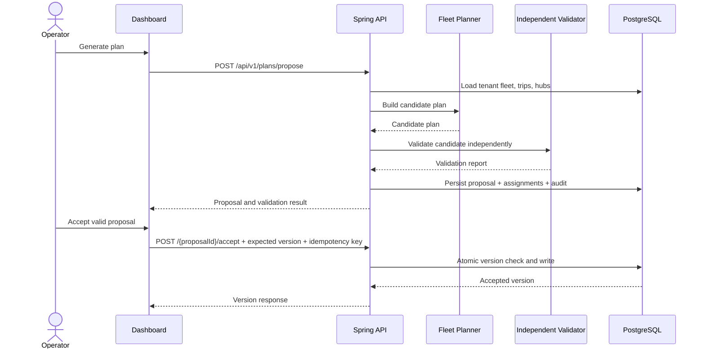

# Additional Delivery: Phases 9–12

These are the additional completion phases added during this packaging pass; they extend the earlier domain, optimizer, validator, replanning, persistence, security and observability work.

## Phase 9 — Operator landing page and fleet dashboard

**Delivered**
- Spring Boot-served responsive single-page dashboard with a visual hero, operational KPIs, trip demand, charger network, fleet readiness, plan studio, live recovery and governance cards.
- Connection settings for API base URL and tenant-scoped key. Settings are stored in browser `localStorage`, not server-side.
- Demo fallback when the API is not available. Demo metrics are illustrative and are labelled as demo mode; they must not be interpreted as live telemetry.
- Trip search and CSV export.

## Phase 10 — Charging network and overview APIs

**Delivered**
- `GET /api/v1/hubs` and `POST /api/v1/hubs`.
- `GET /api/v1/overview` returning authenticated tenant ID, fleet/trip/hub counts, charger inventory, accepted plan version/cost and the reserve floor.
- Hub registration records an audit event. Hub writes are restricted to operator/admin roles.
- Duplicate resource identifiers cannot be used to overwrite another tenant's vehicle, trip or hub.

## Phase 11 — Recovery and operator workflow

**Delivered**
- Dashboard generates a plan proposal, displays the validator result, and exposes a separate acceptance action for valid proposals.
- Acceptance uses the expected current version and a unique idempotency key.
- Battery drift and charger outage actions call live APIs only when the API is connected. Otherwise the UI shows an explicitly labelled simulation message and does not claim a live replan happened.
- Generic server failures avoid returning raw internal exception messages to clients.

## Phase 12 — Packaging, verification and submission readiness

**Delivered**
- Multi-stage Java 21 Dockerfile and Compose stack with PostgreSQL health-gated startup and persistent database storage.
- `.env.example`, runbook, API cURL examples and test checklist.
- New integration tests cover the public dashboard route, asset access, protected APIs, charger hub registration and tenant-scoped overview.

**Verification limitation**

The environment used to assemble this ZIP had Java 21 but no Maven installation or cached Maven distribution. The Maven wrapper attempted to resolve Maven from `repo.maven.apache.org` and failed due DNS/network unavailability. Thus, no new `clean verify` result is claimed here. Run `./mvnw clean verify` or `mvnw.cmd clean verify` on a network-enabled machine before submission.

## Sequence: propose and accept

## Failure-handling matrix

| Failure | Expected behavior | Operational check |
|---|---|---|
| Missing/invalid API key | 401 Problem Details response | Verify `X-API-KEY` and role mapping |
| Viewer attempts mutation | 403 response | Confirm endpoint role matchers |
| Cross-tenant resource ID | Reject with conflict/bad request; do not transfer ownership | Test using two tenant keys |
| Stale expected plan version | 409 conflict; no version increment | Read `GET /api/v1/plans/versions` |
| Repeated idempotency key with same request | Return saved response | Repeat acceptance request |
| Repeated idempotency key with different fingerprint | 409 conflict | Change expected version and replay key |
| Database unavailable | Readiness/health fails; requests do not produce a false success | Inspect app and PostgreSQL logs |
| Browser cannot reach API | UI falls back to demo data and labels it | Use connection settings and browser network panel |
| Planner produces invalid proposal | Proposal is not eligible for acceptance | Inspect validation report JSON |

## Remaining production gaps

The current API-key parser uses predictable local-development key strings and is not production identity infrastructure. The travel model uses an approximate road-distance multiplier and static tariff defaults in persistence-to-domain mapping. Live GPS telemetry, a real charger status feed, external route matrix integration, managed secrets, TLS ingress, and production alerting still require deployment-specific integration. Performance targets must be measured on the intended hardware.
